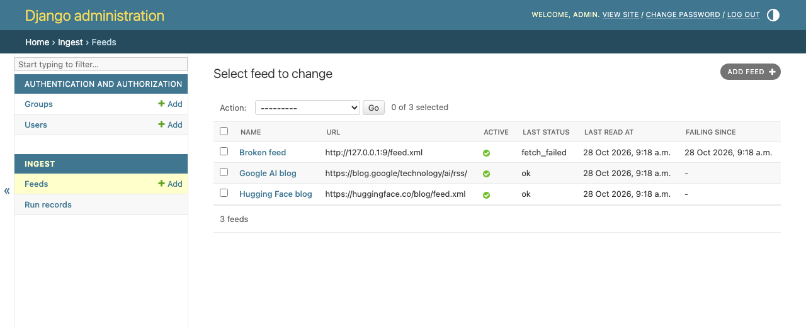

# AI news ingest service

A cron job reads the registered AI news feeds each 15 min and stores one article per canonical URL.

```
crontab, each 15 min -> ingest_feeds -> advisory lock -> active feeds -> fetch, parse -> article table
owner                -> Django admin -> feeds (on, off, health), run records
owner                -> ingest_metric --days N -> on time, excluded, duplicate count
```

| Part | What it does |
|---|---|
| `ingest_feeds` | Runs one pass over the active feeds, then exits. |
| `ingest_metric` | Prints the share of articles stored under 30 min after publication. |
| Django admin | Edits the feeds and lists the run records. |
| Postgres 16 | Holds feeds, articles and run records. It runs in Docker Compose. |



## Design

One bounded context, one aggregate and hexagonal layers. An import contract fails CI when the domain imports a framework.

```
owner, cron -> adapters: admin, commands -> application: IngestPass, FeedCommands -> domain
domain:   Feed, FeedUrl, CanonicalUrl, FetchFailure. No Django, no httpx, no feedparser.
adapters: Django ORM, Postgres lock, httpx and feedparser, system clock
```

| Doc | Read it for |
|---|---|
| [brief.md](docs/brief.md) | The goal, the metric, the user and the scope. |
| [eventstorm.md](docs/eventstorm.md) | The events on a timeline, the hot spots, the commands and the policies. |
| [aggregates.md](docs/aggregates.md) | The rule per command, the guard per rule and the context map. |
| [decisions.md](docs/decisions.md) | 22 dated decisions. Each names the alternatives and the consequence. |
| [plan-deviations.md](docs/plan-deviations.md) | Each place where the build left the plan, with the reason. |

### Trade-offs

Each row names the choice, the option it rejects and the cost the service accepts.

| Topic | Choice | Rejected | Cost accepted |
|---|---|---|---|
| Schedule (D1, D12) | Cron starts a one-shot pass each 15 min. | A long-running worker needs its own timer, restart logic and health check. | An overrun shows only as skip lines in the log. |
| Duplicates (D2) | The store keeps one article per canonical URL. | Title similarity merges short titles such as "GPT-6 is out". | The same story from two sources gives two rows. |
| Unique key (deviation D4) | The key is on `MD5(canonical_url)`. | A plain key fails, because Postgres refuses an index row over 2704 bytes. | Two URLs with one MD5 count as one article. |
| Read deadline (D20) | Each feed read has 10 s in total and a 5 MB body cap. | With a per-read timeout, a slow drip feed holds the pass for minutes. | DNS time is outside the 10 s (deviation D5). |
| Crash safety (D21) | The articles of one feed commit in one transaction. | One transaction per article makes 20x more commits. One per pass loses all on a crash. | A crash leaves one unfinished run record. |
| Feed delete (D15) | Admin refuses to delete a feed with articles. | A cascade delete changes past metric values. | A dead feed stays as an inactive row. |
| Dependency (deviation D2) | `feedparser` stays at 6.0.12. | 6.0.13 adds a 3-month-old package from another org, and its owner is not confirmed. | The parser is one release behind. |

### Rules two requests can break

A test with two Postgres connections proves each guard.

| Rule | Guard | Test |
|---|---|---|
| One article per canonical URL (R6) | Unique key | `tests/integration/test_article_url_race.py` |
| One pass at a time (R3) | Advisory lock | `tests/integration/test_pass_lock.py` |
| A feed with articles stays (R10) | `PROTECT` foreign key | `tests/integration/test_feed_delete_race.py` |

### Known limits

The service accepts these limits.

- A feed read can take 10 s plus its DNS time (deviation D5).
- The first pass stores the whole backlog of each feed. That backlog is not on time, so the share starts low.
  A local first pass gave `on time 0 of 911`. The share is valid once the backlog leaves the 14-day window.

## Install

The app runs on the host. Only Postgres runs in Docker.

```
python3.12 -m venv .venv
.venv/bin/pip install -r requirements.txt
docker compose up -d db
.venv/bin/python manage.py migrate
.venv/bin/python manage.py createsuperuser
```

| Env var | Default |
|---|---|
| `POSTGRES_HOST` | `localhost` |
| `POSTGRES_PORT` | `5432` |
| `POSTGRES_DB` | `ingest` |
| `POSTGRES_USER` | `postgres` |
| `POSTGRES_PASSWORD` | `ingest` |
| `DJANGO_SECRET_KEY` | A local key. Set a real key outside a laptop. |
| `DJANGO_DEBUG` | `1`. Set `0` outside a laptop, together with `DJANGO_ALLOWED_HOSTS`. |
| `DJANGO_ALLOWED_HOSTS` | `localhost,127.0.0.1`. With debug off, a request to any other host gets 400. Set the host names, comma separated. |

## Checks

`make check` runs black, ruff, mypy, the import layer contracts and pytest. The tests need the Postgres container.

```
make check
```

## Schedule

The host crontab starts one pass each 15 min (D1). The app has no timer of its own.

```
*/15 * * * * cd /path/to/ai-news-ingest-service && .venv/bin/python manage.py ingest_feeds
```

| Case | Output | Exit code | Run record |
|---|---|---|---|
| Pass ends | `Pass completed: 2 feeds ok, 0 failed, 2 new articles` | 0 | One, with a finished time. |
| Another pass holds the lock | `Pass skipped: another pass holds the lock` | 0 | None (D10, D12). |
| Pass dies mid-run | None | Not 0 | One, with no finished time. Admin shows it as Unfinished. |

- A skipped tick is normal. Cron sends no mail for it, because the exit code is 0 (D12).
- A long overrun shows only as skip lines in the log and a gap between run records (D10).
- Each feed's articles commit in one transaction. A dead pass keeps every whole feed batch it committed.

## Metric

`ingest_metric` reads the articles stored in the last N days and prints three facts.

```
.venv/bin/python manage.py ingest_metric --days 14
```

```
on time 1,150 of 1,186 = 97.0%, excluded 14
duplicate canonical URLs: 0
```

| Rule | Effect |
|---|---|
| Window | Articles with `stored_at` in the last N days, by the server clock. Default N is 14. |
| On time | `stored_at` is less than 30 min after `published_at`. Exactly 30 min is not on time. |
| Excluded: no date | An article with no `published_at` is left out of the share (D17). |
| Excluded: future date | `published_at` more than 5 min after `stored_at` is left out (D18). Exactly 5 min stays in. |
| Share | On time divided by the articles not excluded, one decimal. No such article prints `n/a`. |
| Duplicates | Canonical URLs with two or more rows, over the whole article table. The unique key keeps it at 0. |
| Warning | Over 5% of the window excluded prints a `WARNING` line. The share is then not valid (D17). |

The target is 95% on time and 0 duplicate canonical URLs (D3).

## Feed admin

The owner edits the feeds in Django admin at `/admin/`. Start it with `.venv/bin/python manage.py runserver`.

| Action | Rule |
|---|---|
| Add a feed | The URL must be absolute http or https. Two feeds cannot have the same URL, compared exactly (D14). |
| Turn a feed off | The next pass skips it. A pass that already started still reads it once (D13). |
| Delete a feed | Admin refuses the delete when the feed has stored articles. Turn the feed off instead (D15). |
| Feed health | The list shows `last_status`, `last_read_at` and `failing_since`. Failing feeds come first, the longest failing at the top (D16). |
| Run records | One row per pass, read only. A row with no finished time shows as Unfinished. |

The decision ids (D1-D22) refer to [docs/decisions.md](docs/decisions.md).
